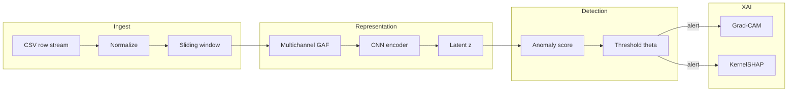

# XCDT-ICS — Agent Context Plan

**Full title:** Explainable Contrastive Learning for Industrial Control Systems — Digital Twin–Enabled Industrial Anomaly Detection

**How to use this document:** Coding agents should read **§1 Agent briefing** and **§2 Invariants** before any change, then jump to the section that matches the task (data pipeline, model, training, XAI, dashboard, eval). Human-oriented narrative (venues, SDG, publication) is condensed under **§14 Research appendix**.

---

## Document map (quick navigation)

| Section | Use when you are… |
|--------|-------------------|
| [§1 Agent briefing](#1-agent-briefing) | Starting cold; need scope, stack, and success criteria |
| [§2 Invariants](#2-invariants-do-not-violate) | Checking constraints, leakage, or evaluation rules |
| [§3 Glossary](#3-glossary) | Aligning on acronyms and component names |
| [§4 System architecture](#4-system-architecture) | Wiring modules or tracing data flow |
| [§5 Data specification](#5-data-specification) | Loading SWaT/WADI, splits, windowing, GAF shapes |
| [§6 Algorithms](#6-algorithms-softclt--gaf--scoring) | Implementing loss, GAF, or anomaly score |
| [§7 Model specification](#7-model-specification) | CNN encoder, heads, scoring options |
| [§8 Training protocol](#8-training-protocol) | Hyperparameters, augmentations, threshold tuning |
| [§9 XAI specification](#9-xai-specification) | Grad-CAM, SHAP, explanation payloads |
| [§10 Replay & dashboard](#10-replay-simulation--dashboard) | Streamlit demo, replay engine, panels |
| [§11 Evaluation](#11-evaluation) | Metrics, baselines, ablations, experiment checklist |
| [§12 Dependencies & repo hygiene](#12-dependencies--repo-hygiene) | `requirements`, Docker, CI, style |
| [§13 Roadmap & risks](#13-roadmap--risks) | Phasing work over four months |
| [§14 Research appendix](#14-research-appendix) | Gaps, contributions, venues, SDG |

---

## 1. Agent briefing

### 1.1 One-line goal

Build **XCDT-ICS** (eXplainable Contrastive Digital Twin for ICS): a **self-supervised** anomaly detector on multivariate ICS time series that uses **SoftCLT + multichannel GAF + CNN encoder**, **latent-space deviation scoring** (digital twin view), and **Grad-CAM + SHAP** explanations, with a **Streamlit** replay dashboard for SWaT/WADI-style CSV streams.

### 1.2 Core stack (authoritative)

| Layer | Choice |
|-------|--------|
| Core ML | PyTorch ≥ 2.0 |
| Training orchestration | PyTorch Lightning ≥ 2.0 (recommended) |
| Data | NumPy ≥ 1.24, Pandas ≥ 2.0 |
| GAF | `pyts` ≥ 0.12; sklearn for scaling utilities |
| Grad-CAM | `pytorch-grad-cam` ≥ 1.4 |
| SHAP | `shap` ≥ 0.43 (KernelSHAP as specified) |
| Dashboard | Streamlit; Plotly (live) + Matplotlib (static heatmaps) |
| Tracking | Weights & Biases (optional but specified) |
| Language / runtime | Python 3.10+; GPU NVIDIA RTX 3090 class or equivalent for training |

### 1.3 Primary success criteria (evaluation-time)

1. **FPR < 0.05** on normal validation data (after threshold calibration on held-out normal validation only).
2. **F1** exceeds all specified baselines on **SWaT** test (under the same FPR constraint protocol).
3. **XAI:** SHAP attribution identifies the **manipulated sensor** in **≥ 70%** of evaluated attack scenarios (per project definition).

### 1.4 Suggested repository layout (agents may adapt; keep boundaries)

```text
src/
  data/           # loaders, splits, normalization (no leakage helpers)
  transforms/     # windowing, GAF/GASF/GADF, tensor caches
  models/         # CNN encoder, projection head, optional VAE
  losses/         # SoftCLT with soft weights w(i,j)
  scoring/        # VAE recon error | Mahalanobis | k-NN latent distance
  xai/            # Grad-CAM hooks, SHAP wrappers, faithfulness@k
  replay/         # row-by-row CSV streamer, configurable Hz / speedup
  dashboard/      # Streamlit app (thin UI over inference + replay)
  eval/           # metrics, baselines adapters, experiment configs
configs/          # Hydra/YAML or Lightning CLI — single source of hyperparams
tests/            # pipeline + model load + no-future-leak invariants
```

**Rule:** Keep **training**, **threshold calibration**, and **attack-metric computation** in separate code paths or configs so agents do not accidentally pass attack labels into fit.

---

## 2. Invariants (do not violate)

- **Training:** normal-operation windows **only**. No attack labels in training loss or validation used for early stopping if that validation is also used for threshold — document clearly; safest pattern is **normal train / normal val (early stop) / normal threshold-cal / normal test FPR / attack test**.
- **Normalization:** per-sensor **z-score** (or project-chosen scaler) statistics computed **only on the training split** of **normal** data; persist and apply to val/test/replay.
- **Online replay:** at time `t`, the model may use only **current and past** readings when forming the window `[t−W+1, t]` (or `[t−W, t]` per chosen convention) — **no future rows**.
- **Attack labels:** used **only** for test-set detection metrics and attribution accuracy — never for training or threshold tuning.
- **ICS false-alarm cost:** treat **FPR** as a first-class metric; threshold tuning is **FPR-targeted** on normal validation (or dedicated normal calibration split).
- **Augmentations:** **soft** Gaussian noise, mild temporal scaling — must **not** destroy temporal order (no random permutations that break sequence semantics for ICS).

---

## 3. Glossary

| Term | Meaning |
|------|---------|
| **ICS** | Industrial Control Systems; SCADA/PLC/sensor/actuator cyber-physical stack |
| **XCDT-ICS** | This system: SoftCLT + GAF CNN encoder + latent deviation scoring + dual XAI |
| **SoftCLT** | Soft contrastive learning for time series: pair weights `w(i,j) ∈ [0,1]` from temporal proximity / similarity (e.g. DTW-based), not binary positives/negatives only |
| **GAF / GASF / GADF** | Gramian Angular (Summation/Difference) Field: 1D window → 2D matrix encoding temporal self-similarity |
| **Digital twin (here)** | Learned manifold of **normal** behavior: encoder `φ: X → Z`; anomalies = large deviation of `z*` from `P(Z | normal)` |
| **FPR / F1 / AUC-PR** | Standard detection metrics; FPR is emphasized for operator trust |

---

## 4. System architecture

### 4.1 Pipeline stages (inference)

1. **Ingest** multivariate stream `X` with `N` sensors; normalize using **train-derived** stats.
2. **Window** overlapping segments of length `W`, stride `S`.
3. **GAF:** per-sensor GASF (optional + GADF); stack to tensor shape **`[N, W, W]`** (batch: `[B, N, W, W]` if channels-first) — align with CNN API explicitly in code.
4. **Encode:** CNN + projection → latent **`z`** (dimension `D`).
5. **Score:** anomaly score `A(x)` vs learned normal distribution (VAE recon, Mahalanobis, or k-NN — pick one for deployment; compare in research).
6. **Explain (on alert):** Grad-CAM on CNN + KernelSHAP on scorer inputs → **timestep saliency** + **sensor ranking**.

### 4.2 Data-flow diagram (Mermaid)



---

## 5. Data specification

### 5.1 Datasets (reference)

**SWaT (Secure Water Treatment)** — iTrust / SUTD; CSV; **51** sensors/actuators; **1 Hz**; ~7 days normal + ~4 days attacks; **41** attack scenarios; attack label column for **eval only**.

**WADI (Water Distribution)** — same portal family; **123** sensors/actuators; **1 Hz**; longer normal period; **15** attacks; harder / longer / subtler deviations.

Access: iTrust portal (registration). Fallback if delayed: **BATADAL** (named in risk register; confirm license terms before shipping benchmark code).

### 5.2 Default windowing (treat as config defaults, not hardcoded magic)

| Parameter | Default | Notes |
|-----------|---------|--------|
| `W` | 60 | timesteps (~60 s at 1 Hz); **ablate** as hyperparameter |
| `S` | 10 | stride |
| Missing values | linear interpolate | gaps **> 5 s** flagged per spec |

### 5.3 Splits (normal-only train/val; attack only in test eval)

| Split | Source | Approx. share | Purpose |
|-------|--------|---------------|---------|
| Train | Normal only | 70% of normal | Self-supervised training |
| Val (normal) | Normal only | 15% | Early stopping; optional secondary normal metrics |
| Threshold cal | Normal only | use held-out normal **not** used for training if strictest; at minimum **never** attack-labeled |
| Test (normal) | Normal only | 15% of normal | **FPR** on clean windows |
| Test (attack) | Attack periods | all attack windows | Recall, F1, AUC, attribution accuracy |

### 5.4 Tensor shapes (agent checklist)

- Raw window: `[B, N, W]` (or `[B, W, N]` — **pick one convention** and use everywhere).
- After GASF stack: **`[B, N, W, W]`** before conv — if using `Conv2d(in_channels=...)`, either **channel = N** or reshape to **`[B, 1, N*W, W]`** — **document chosen layout** in `README` or `configs/default.yaml` only if repo already uses that pattern (avoid new docs unless repo standard).

---

## 6. Algorithms (SoftCLT / GAF / scoring)

### 6.1 SoftCLT (conceptual contract)

- Replace hard positive/negative with **weights** `w(i,j)` from **temporal proximity** and **similarity** (e.g. DTW) between windows `i, j`.
- Loss form (conceptual):  
  `L_soft = Σ_{i,j} w(i,j) · L_contrastive(z_i, z_j)`  
  Adjacent windows → higher positive weights; dissimilar/distant → negative-weight contribution scaled by dissimilarity.
- **Implementation task:** define how `w` is computed and batched efficiently; start from hard CL + **anneal** to soft weights if unstable (see risks).

### 6.2 Multivariate GAF

- Per sensor: normalize series to valid domain for arccos mapping; build GASF (and optional GADF).
- Stack **N** GAF matrices as **N channels** (analogous to RGB) so CNN can learn **cross-sensor** structure; project text also mentions **depthwise separable** + **grouped** convolutions for within-/cross-sensor patterns.

### 6.3 Anomaly scoring (implement as pluggable `Scorer` interface)

| Option | Score | Notes |
|--------|-------|--------|
| **A** | VAE reconstruction MSE on GAF input | Recon error as anomaly signal |
| **B** | Mahalanobis distance of `z` to Gaussian fit of **normal** train latents | Fast at inference if cov precomputed |
| **C** | k-NN distance in latent space to stored **normal** embeddings | Memory/speed tradeoff |

**Threshold `θ`:** tune on **normal** calibration data to hit target FPR (e.g. ≤ 0.05).

---

## 7. Model specification

### 7.1 CNN encoder (reference architecture)

| Stage | Layer | Config | Output shape (conceptual) |
|-------|-------|--------|-------------------------|
| 1 | Conv2D + BN + ReLU | 32 filters, 3×3 | `[B, 32, W, W]` |
| 2 | Conv2D + BN + ReLU | 64 filters, 3×3 / stride 2 | `[B, 64, W/2, W/2]` |
| 3 | Depthwise separable conv | 128 filters, 3×3 | `[B, 128, W/4, W/4]` |
| 4 | Global average pooling | — | `[B, 128]` |
| 5 | Projection MLP | 128 → 128 → **D** | `[B, D]` |

Pad/crop rules must keep shapes consistent for arbitrary `W` (prefer **explicit padding** in code comments only where non-obvious).

### 7.2 Training hyperparameters (defaults from plan)

| Setting | Value |
|---------|--------|
| Optimizer | AdamW |
| LR | 1e-3 initial, cosine decay to **min 1e-5** |
| Batch size | 256 (window **pairs** as needed by loss) |
| Epochs | 100, early stopping **patience 10** |
| Augmentation | Gaussian noise σ=0.01; temporal scale ×0.9–1.1 (**order-preserving**) |

---

## 8. Training protocol

- **Loss:** SoftCLT with documented `w(i,j)`.
- **Checkpoints:** version with git SHA + config hash.
- **Threshold:** separate script or Lightning callback that **only** reads normal scores.
- **Logging:** W&B for hyperparams and curves (optional but aligned with plan).

---

## 9. XAI specification

### 9.1 Grad-CAM (temporal / GAF-space saliency)

- Register hook on **final** CNN conv layer.
- Compute gradient of **anomaly score** w.r.t. that layer’s activations.
- Global-average-pool gradients → weights; weighted sum of feature maps; upsample to GAF resolution; **decode** to wall-clock / timestep interpretation for operators.

### 9.2 SHAP (sensor attribution)

- **KernelSHAP** with **sensor channels** as features.
- Background = samples from **normal** training windows.
- Output: **ranked sensors** + optional uncertainty display; bar chart in UI.

### 9.3 Operator-facing explanation payload (schema suggestion)

Agents implementing APIs should expose a structured object, e.g.:

```json
{
  "timestamp_utc": "2026-05-14T14:23:07Z",
  "score": 0.84,
  "threshold": 0.65,
  "severity": "High",
  "top_sensors": [{"id": "P-302", "role": "flow", "shap_fraction": 0.41}],
  "critical_time_window_utc": ["2026-05-14T14:22:45Z", "2026-05-14T14:23:05Z"],
  "artifacts": {"gradcam_path": "...", "shap_plot_path": "..."}
}
```

Plain-language summary string is **generated** from this structure for Panel 3.

### 9.4 Explainability evaluation (when running experiments)

- **Faithfulness@k:** mask top-k attributed sensors/timesteps vs random masks — measure score drop.
- **Comprehensiveness / consistency:** optional metrics and attack-type–conditioned repeatability.

---

## 10. Replay simulation & dashboard

### 10.1 Replay semantics

- **Not** a physics plant simulator: **CSV replay** at configurable Hz (e.g. **10×** for demos: 1 h wall → 6 min).
- SWaT-like trace: sequential rows, **no peeking** at future rows for scoring window construction.
- Per timestep pipeline: **encode** window ending at `t` → **score** → **alert** if `A_t > θ` → run XAI in **~1–2 s** target.

### 10.2 Streamlit dashboard — four panels

| Panel | Content |
|-------|---------|
| **1** | Live multi-sensor lines; **digital twin “expected normal”** overlay (dashed) when defined by project |
| **2** | Anomaly score time series (~last 300 steps); threshold line; green/red background by alert |
| **3** | Alert card: SHAP bars; Grad-CAM on GAF; plain-language summary |
| **4** | Static baseline comparison table (F1, FPR, AUC-ROC) — SWaT & WADI |

**Stack:** Streamlit + Plotly + Matplotlib + preloaded PyTorch checkpoint + `pytorch-grad-cam` + `shap`. **Refresh ~1 s** during replay. **Local / offline** demo acceptable.

### 10.3 Examiner demo script (for humans; agents implement hooks)

1. Start replay → normal region → score near baseline.  
2. Enter known attack window (e.g. SWaT attack involving **MV-101**) → score rises.  
3. Cross threshold → Panel 3 under **2 s**.  
4. Show SHAP top sensor aligns with **ground-truth** manipulated variable (eval-only knowledge).  
5. Panel 4: contrast **FPR** vs baselines (e.g. project claims XCDT-ICS **0.03** vs LSTM-AE **0.14** — replace with measured numbers once runs exist).

---

## 11. Evaluation

### 11.1 Detection metrics

Report at minimum: **Accuracy**, **Precision**, **Recall**, **F1**, **FPR** (primary for ICS narrative), **AUC-ROC**, **AUC-PR**. Always report **with threshold policy** documented.

### 11.2 Baselines (implement or adapter)

| Baseline | Notes |
|----------|--------|
| Isolation Forest | Classical, weak temporal |
| One-Class SVM | Kernel boundary |
| LSTM Autoencoder | Reconstruction score |
| CNN Autoencoder | On raw windows |
| TS2Vec | Hard CL + augmentations — temporal destruction concern |
| CARLA | Contrastive TS — compare without XAI |

### 11.3 Ablations

| Variant | Change |
|---------|--------|
| Full | XCDT-ICS as specified |
| A | Hard contrastive instead of SoftCLT |
| B | No GAF — raw normalized windows to encoder (adapt dims) |
| C | No XAI — detection only |
| D | No “digital twin” path — simple AE, no contrastive pretrain |

### 11.4 Experiment checklist (agents / CI-friendly)

- [ ] **E1** Main table: XCDT-ICS vs all baselines on **SWaT**; repeat **WADI**; paired tests + multiple-run seeds where feasible.  
- [ ] **E2** Ablations A–D on SWaT; ΔFPR vs full.  
- [ ] **E3** Threshold sensitivity: FPR–Recall curve; ±10% threshold robustness.  
- [ ] **E4** XAI faithfulness@k (top-3 sensors).  
- [ ] **E5** Per attack-type breakdown (single-point, multi-point, stealth, long-duration).

### 11.5 Hypotheses (for paper; agents use as regression targets after first full run)

- **H1:** FPR ≤ 0.05 vs baselines mean FPR ≥ ~0.12 on SWaT (numbers are hypotheses — **overwrite with measured**).  
- **H2:** F1 gain ≥ **5** pp vs TS2Vec/CARLA on SWaT (validate empirically).  
- **H3:** SHAP sensor match ≥ **70%** on single-point attacks.

---

## 12. Dependencies & repo hygiene

| Concern | Choice |
|---------|--------|
| Env | Conda (preferred) or `venv` |
| VCS / data | Git + DVC for dataset artifacts |
| CI | GitHub Actions: **data pipeline smoke**, **model load**, **import graph** |
| Container | Docker with **pinned** deps |
| Style | Black, Flake8, **type hints** on public APIs |

**Hardware:** GPU 24 GB class; **32 GB+ RAM** for WADI-scale preprocessing; **~500 GB SSD** for cached GAF tensors + checkpoints; cloud alternatives acceptable.

---

## 13. Roadmap & risks

### 13.1 Four-month phased plan

| Month | Phase | Tasks | Deliverable |
|-------|-------|-------|-------------|
| **1** | Foundation | Literature skim; dataset access; EDA; preprocess + **baselines** (IF, OCSVM, LSTM-AE, CNN-AE) | Preprocessed artifacts; baseline table; notes |
| **2** | Core pipeline | Multivariate GAF; CNN encoder; **SoftCLT** loss + weighting; first encoder runs on SWaT | GAF pipeline; trained encoder; validated loss |
| **3** | Train & eval | Full model SWaT/WADI; scorer comparison; threshold cal; ablations; TS2Vec/CARLA compare | Results table; checkpoints; ablation report |
| **4** | XAI + demo + writeup | Grad-CAM + SHAP + faithfulness; Streamlit replay + 4 panels; demo rehearsal; paper | Dashboard; XAI report; submission draft |

### 13.2 Risk register

| Risk | L | I | Mitigation |
|------|---|---|------------|
| GAF too slow on WADI | M | H | Precompute/cache tensors; parallel CPU |
| SoftCLT unstable | M | H | Grad clip; hard CL warm-start → anneal soft weights |
| XAI not faithful | L | M | Try Integrated Gradients; reduce CNN depth |
| Dataset access delay | L | H | Early iTrust registration; BATADAL interim |
| Strong TS2Vec/CARLA | L | M | Emphasize FPR story; enrich WADI + ablations |

---

## 14. Research appendix

### 14.1 Executive summary (human)

ICS need **low FPR**, **no attack labels**, and **interpretable** alarms. XCDT-ICS combines **SoftCLT** (temporal structure), **GAF+CNN** encoding, a **learned digital twin** (latent normal manifold), and **Grad-CAM + SHAP** for timestep- and sensor-level explanations, evaluated on **SWaT** and **WADI**.

### 14.2 Problem & gaps (condensed)

**Challenges:** label scarcity, high cost of FP, black-box distrust, temporal structure, concept drift.

**Gaps addressed:** (1) temporal destruction in hard CL, (2) lack of learned-twin + representation integration, (3) multivariate GAF for CNNs, (4) integrated XAI for GAF-based ICS scoring, (5) SoftCLT on SWaT/WADI-style benchmarks.

### 14.3 Contributions list (publication-facing)

1. SoftCLT-style objective for **multivariate ICS** windows.  
2. **Learned** digital twin via latent normal distribution + deviation score.  
3. **Multi-channel GAF** pipeline for N sensors + CNN.  
4. **Dual XAI:** Grad-CAM + SHAP with operator-oriented outputs.  
5. **Benchmark** vs six baselines + four ablations on SWaT & WADI.

### 14.4 Target venues (non-binding)

IEEE TII, Applied Soft Computing, IEEE IoT-J, Information Sciences; conferences ICDM/AAAI as backup.

### 14.5 SDG alignment (single block)

**SDG 9** — resilient infrastructure (9.1), sustainable industrialization (9.2), safer/cleaner industrial ops (9.4), domestic tech capacity (9.B): anomaly detection reduces downtime and environmental risk from attacks **and** from unnecessary shutdowns.

### 14.6 Immediate next steps (on project start)

1. Request **SWaT/WADI** access (iTrust).  
2. Initialize repo: **DVC**, Docker, CI smoke tests.  
3. Implement **IF + LSTM-AE** anchors early (end week 2 target).  
4. **Streamlit skeleton** (layout-only) can proceed in parallel with Month 2 pipeline.

---

## Agent task prompts (copy-paste starters)

Use these as **system or user preambles** when spawning subagents:

- **Data:** “Implement §5 with split invariants from §2; expose a `WindowedDataset` that never reads future rows in replay mode.”  
- **Model:** “Implement §7 encoder + §6.3 `Scorer` interface; config-driven `D`, `W`, `S`.”  
- **Loss:** “Implement §6.1 SoftCLT with numerically stable weighting and tests on toy windows.”  
- **XAI:** “Implement §9 on flagged windows only; return schema in §9.3.”  
- **Dashboard:** “Implement §10.2 panels on top of `replay` + `scoring` APIs; no training in dashboard process.”

---

*End of agent context plan.*
